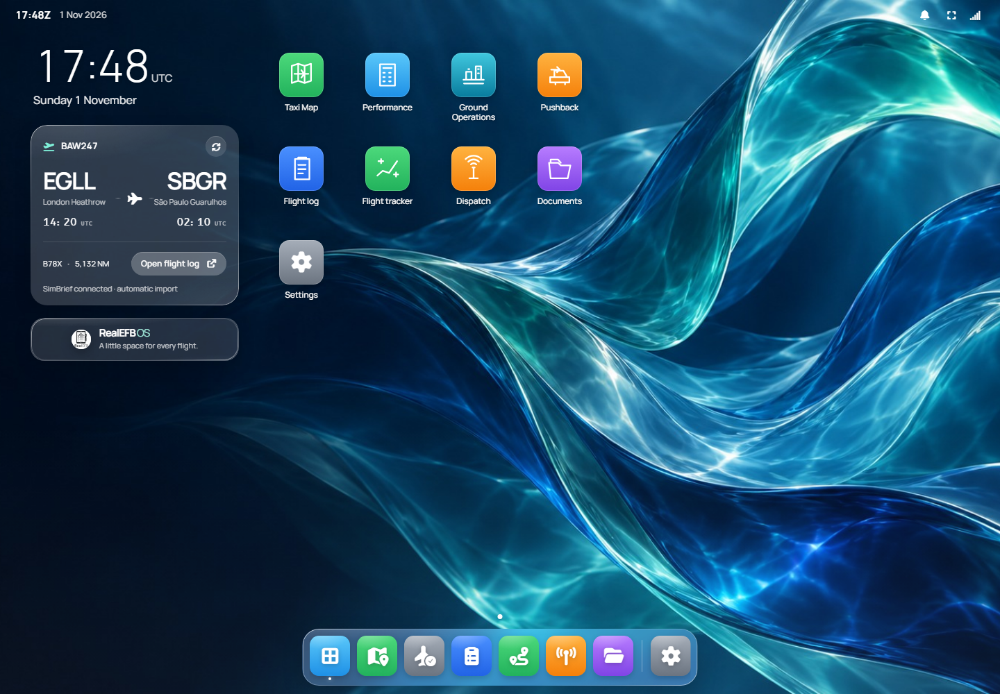
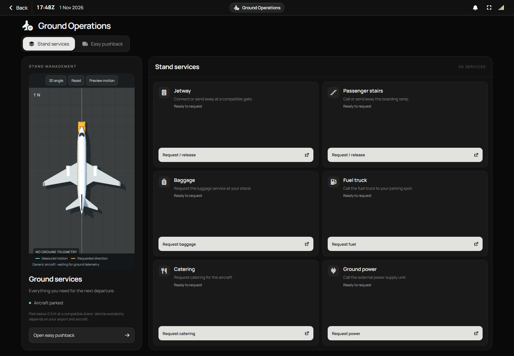
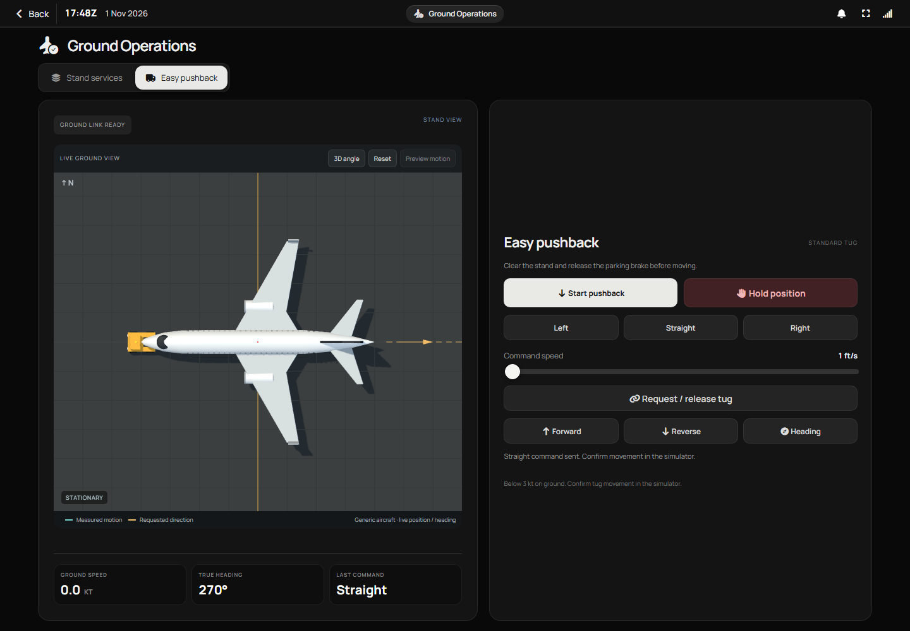
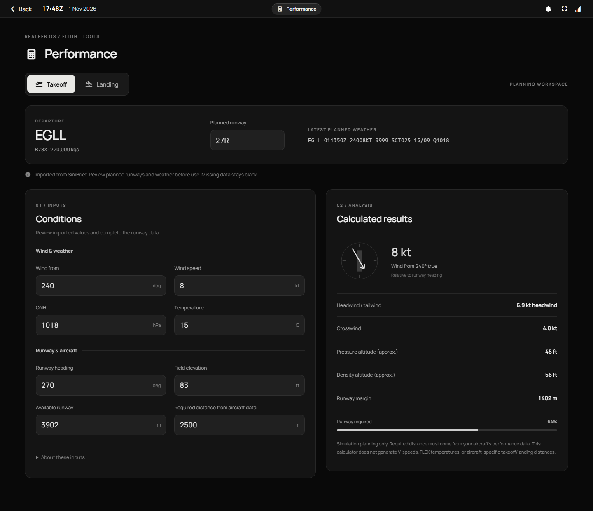
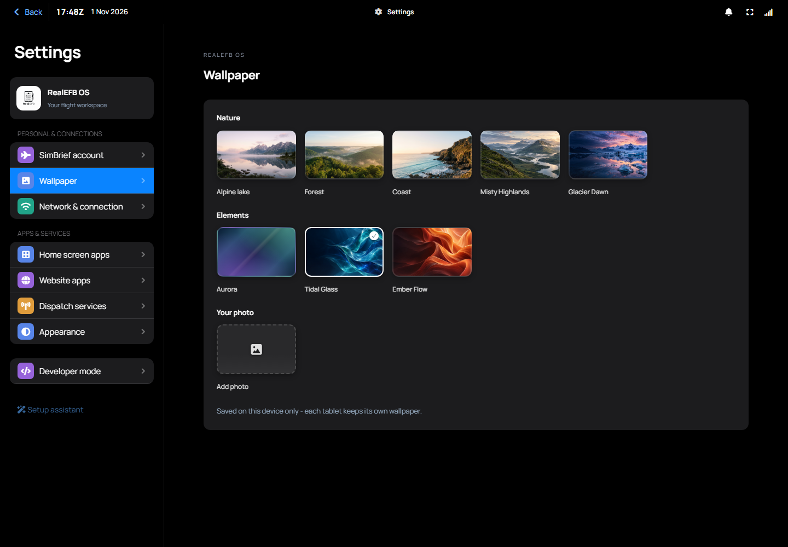
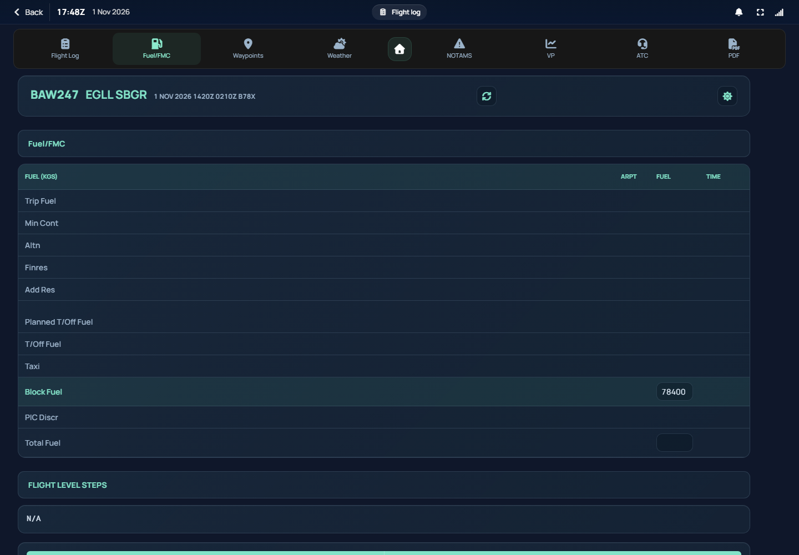
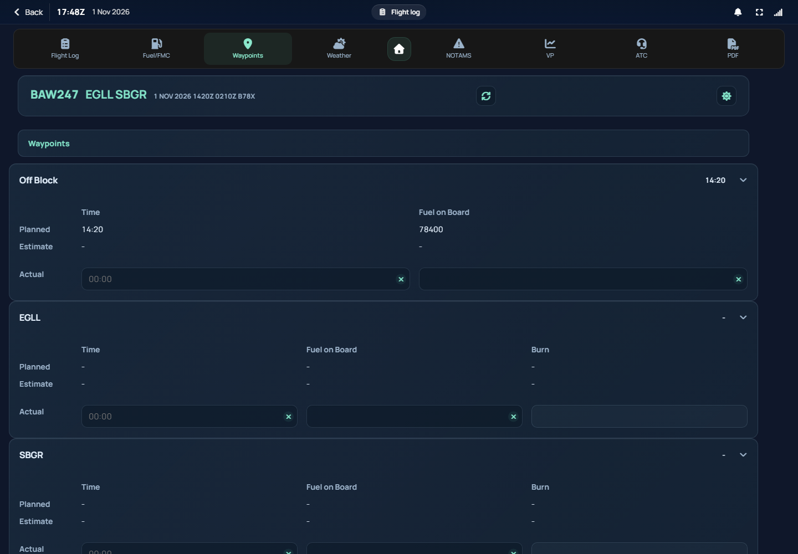
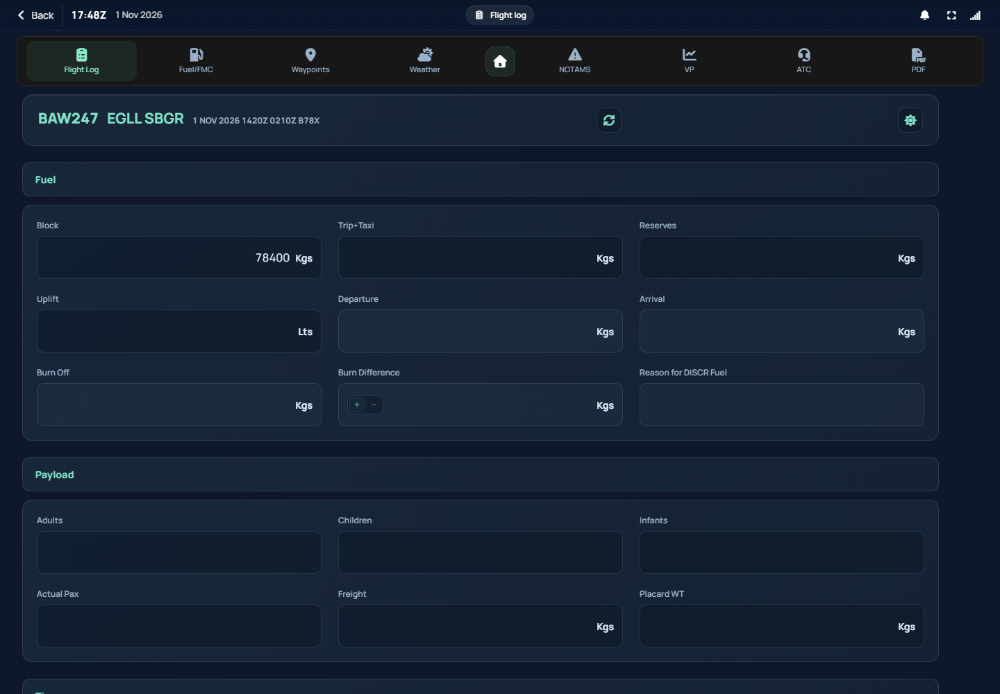

# RealEFB

[](https://discord.gg/Qpxg4tZCc8)

A self-hosted Electronic Flight Bag built to feel like the real thing — SimBrief flight plans, an airline-style flight log, and live dispatch, usable from a tablet on your network.

RealEFB runs as a Windows desktop app and serves its interface over your LAN. The host shares flight-plan and flight-log data with connected browsers and tablets, and records the flight trail even when the map is closed. Device preferences such as wallpaper are saved locally.



## Features

- **SimBrief integration** — import your latest flight plan by username or pilot ID, no manual entry.
- **EFL (Electronic Flight Log)** — Fuel/FMC, Waypoints (planned vs. actual times, fuel, and burn per leg), Weather, NOTAMs, Vertical Profile, ATC, and the original OFP as a PDF.
- **Flight Log** — departure/arrival fuel and burn are computed automatically from what you enter on Waypoints, "Reason for DISCR Fuel" only unlocks once PIC Discr crosses 200kg/lbs, delays are logged against the real Standard IATA Delay Codes (AHM730/731) instead of free text, and Total Flight/Total Block only ever show once both of the times they depend on are actually in.
- **Flight Tracker** — a live moving map of the SimBrief route (origin, every navlog fix, destination) with the aircraft's live SimConnect position, a rotating aircraft symbol, and a flown-track trail. The trail is recorded on the server for the whole flight regardless of whether the tab is open anywhere, so opening it mid-flight shows everything flown so far — not just what accumulated since you tapped it.
- **Log Flight** — saves a flight-log PDF straight to `Documents\RealEFB Documents\FlightLogs` on the PC running RealEFB. Works the same from the desktop app or any tablet on the network — it's a plain request either way.
- **Dispatch** — preliminary/final loadsheets, gate requests, and weather via SayIntentions.AI or VATSIM. 
- **Documents** — a local PDF viewer for anything dropped into your `Documents\RealEFB Documents` folder.
- **Website Apps** — add any site as its own home-screen app, with your own name, URL, and (optionally) an icon you upload yourself. all editable or removable. One-click presets are also offered for [SimPrinter](https://github.com/matsan000/SimPrinter) and [SimCallouts](https://github.com/matsan000/SimCallouts)' own local web dashboards, if you run either. Embedded in the app on desktop, opened as a new tab on a tablet's browser.
- **Live sim data** — reads aircraft state from Microsoft Flight Simulator via SimConnect when it's running. The status bar always shows a Zulu clock — the sim's own Zulu time once connected, your device's real-world UTC time otherwise.
- **Ground Operations** — request jetway, passenger stairs, baggage, fuel, catering, and ground power from a compact service board. Requests depend on airport scenery, aircraft support, and any third-party service add-ons.
- **Interactive 3D pushback** — top-down aircraft and tug models, measured position and heading, movement arrows, a flown ground track, and a separate requested-direction guide. Inspect an angled view, pan, zoom, or recenter. An explicitly labelled offline motion preview sends no simulator commands.
- **Easy pushback** — start, hold position, steer left/straight/right, set command speed, request/release the tug, move forward/reverse, and enter a target heading.
- **Performance** — separate takeoff/landing inputs, SimBrief weather and runway information, wind preview, pressure/density altitude estimates, runway margin, and runway utilization.
- **Responsive UI** — shared fonts and controls, a horizontal home dock, compact ground workspaces, mobile Settings navigation, and internally scrolling flight-log tables.
- **Settings** — grouped account, wallpaper, network, app, dispatch, appearance, and developer pages. Copy complete tablet URLs from Network & connection.
- **Command Center** — brightness and alert-volume controls, Do Not Disturb, sound preferences, connection status, and notification history.
- **System tray mode** — close the desktop window while browser/tablet access and SimConnect remain running; reopen or exit completely from the tray menu.

## Screenshots

Screenshots show the current interface with sample flight data and simulated connection state, not a live flight.

| Ground Operations | Interactive 3D pushback |
| --- | --- |
|  |  |

| Performance | Wallpaper collections |
| --- | --- |
|  |  |

| Fuel/FMC | Waypoints | Flight Log |
| --- | --- | --- |
|  |  |  |

## Ground controls and performance

Park below **0.5 kt** to request stand services. Pushback movement controls require an aircraft on the ground below **3 kt**; Hold Position sends zero tug speed. Clear the stand and release the parking brake before moving.

The 3D aircraft and tug are generic models. Aircraft position and true heading come from SimConnect. Cyan arrows and the trail show measured movement; the amber path and tug articulation show requested steering. The view does not confirm physical tug attachment or service completion. The 3D view requires WebGL/hardware acceleration.

Performance calculations are simulation planning aids. Review imported conditions, enter a verified true runway heading, and obtain required runway distance from the aircraft's performance data. RealEFB does not generate aircraft-specific V-speeds, FLEX temperatures, or certified takeoff/landing distances.

## Wallpapers

Open **Settings → Wallpaper** to browse the **Nature** and **Elements** collections or upload your own photo. Existing choices and custom photos are preserved, and wallpaper preferences are saved per device.

Four new original AI-generated wallpapers are bundled locally:

| Elements: Tidal Glass | Elements: Ember Flow |
| --- | --- |
|  |  |

| Nature: Misty Highlands | Nature: Glacier Dawn |
| --- | --- |
|  |  |

Alpine Lake, Forest, Coast, Aurora, and custom photo uploads remain available.

## Requirements

- Windows 10/11 (x64) — no separate .NET runtime install needed, RealEFB ships with its own
- A [SimBrief](https://www.simbrief.com/) account, for flight plan import
- Microsoft Flight Simulator 2024 — optional, only needed for live sim data
- Microsoft Edge WebView2 Runtime for the embedded desktop interface, and a WebGL-capable browser for the interactive 3D view

## Getting started

1. Install Node.js 22.12+ (or 24 LTS) and build `src/RealEFB/RealEFB.csproj` (or open `RealEFB.slnx`) with the .NET 10 SDK. The build compiles the React/TypeScript frontend into the existing static web root; Node is not needed by end users.
2. Run `RealEFB.exe`. RealEFB OS opens its app launcher after a brief boot screen. Save your SimBrief ID once in Settings; the latest plan imports automatically when no flight is loaded. An existing flight is preserved across reloads. Documents, Settings, and the launcher are available without importing a flight. Optional setup is available from Settings.
3. To use RealEFB on a tablet, open **Settings → Network & connection**, use **Copy** beside the address for your shared network, then open that URL on the tablet (default port `5150`). A changed server port takes effect after restarting the host.

## System tray mode

Closing the window with **X** keeps the server and simulator connection running in the Windows system tray. Browser and tablet access continue at the same addresses.

- Double-click the tray icon, or choose **Open RealEFB**, to restore the desktop window.
- Choose **Open in browser** to open the local web app in your default browser.
- Choose **Hide to system tray** to hide the window explicitly.
- Choose **Exit RealEFB** to quit completely and stop the server. Windows shutdown also exits normally.

## Refreshing the screenshots

After building the frontend and installing Playwright Chromium (`npx playwright install chromium` from `frontend`), run this from the repository root:

```powershell
node frontend/scripts/capture-readme.mjs
```

The script captures the built UI using an isolated local static server and sample data. It does not change a running RealEFB session or the host's saved settings. Frontend build and test instructions are in [frontend/README.md](frontend/README.md).

## Contributing

Contributions are welcome — see [CONTRIBUTING.md](CONTRIBUTING.md) for how to build, run, and submit changes.

## License

MIT — see [LICENSE](LICENSE). Bundled third-party components, including Three.js, Leaflet, and the SimConnect redistributables, retain their own licenses.


